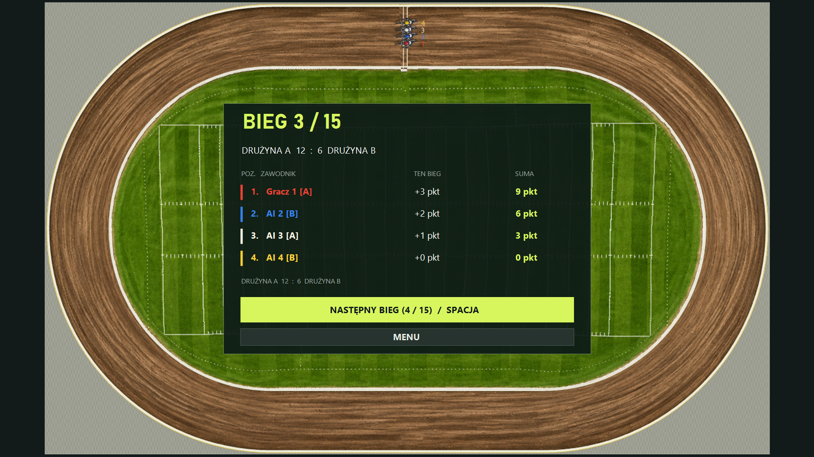

# Żużel

Samodzielna gra żużlowa dla Windows x64, z widokiem toru z góry. Działa offline, bez przeglądarki i bez konta.

Gotowy plik **Zuzel-1.5.exe** jest w sekcji **Releases** tego repozytorium. Pobierz go i uruchom; osobna instalacja .NET nie jest potrzebna.

## Rozgrywka

- 1–4 graczy przy jednym komputerze; pozostałymi zawodnikami kieruje AI.
- Turniej indywidualny albo mecz drużynowy, po **15 biegów**.
- Każdy bieg ma cztery okrążenia. Punkty **3–2–1–0** sumują się po biegu.
- Drużyna A: zawodnicy 1 i 3. Drużyna B: 2 i 4.
- Ręczny gaz i skręcanie, poślizgi, kolizje oraz wykluczenie za wjazd w taśmę.
- Rotacja pól startowych między biegami i klasyfikacja końcowa na murawie.
- Pełny ekran przy uruchomieniu, obsługa padów XInput i konfigurowalne klawisze.



## Sterowanie

| Zawodnik | Gaz | Skręt w lewo | Skręt w prawo |
| --- | --- | --- | --- |
| 1 — czerwony | W | A | D |
| 2 — niebieski | ↑ | ← | → |
| 3 — biały | I | J | L |
| 4 — żółty | Num 8 | Num 4 | Num 6 |

**Spacja / Enter:** start i następny bieg. **P:** pauza. **F2:** przypisanie klawiszy. **F3:** licznik FPS. **F11:** pełny ekran / okno. **M:** dźwięk.

Na starcie czekaj na podniesienie taśmy. Wjazd w taśmę wyklucza zawodnika z biegu i daje 0 punktów.

Pad Xbox / XInput: RT lub A to gaz, lewy drążek albo krzyżak to skręt. Numer pada odpowiada numerowi zawodnika. Obsługa padów jest zaimplementowana; nie była testowana na fizycznie podłączonych kontrolerach.

Niektóre klawiatury ograniczają liczbę jednoczesnych naciśnięć. Można zmienić przypisania lub skorzystać z padów.

## Budowanie

Wymagany Windows i .NET SDK 10. Projekt nie wymaga dodatkowych pakietów NuGet poza platformą .NET/Windows Desktop.

```powershell
dotnet build src/Zuzel/Zuzel.csproj -c Release
dotnet publish src/Zuzel/Zuzel.csproj -c Release -o publish
```

Wynik to samodzielny `publish/Zuzel.exe` dla Windows x64. Grafiki i nagranie silników są osadzone wewnątrz EXE.

## Testy

```powershell
$test = Start-Process -FilePath ./publish/Zuzel.exe -ArgumentList '--self-test' -Wait -PassThru
$test.ExitCode
Get-Content verification.txt
```

Testy obejmują fizykę, odzyskanie sterowania po kolizji, taśmę, powtarzane wiadomości klawiatury, animację, punktację oraz kompletny mecz z 15 biegami. Raport wersji 1.5: [verification-1.5.txt](docs/verification-1.5.txt).

Opcje diagnostyczne:

```powershell
./publish/Zuzel.exe --render-stress performance.txt
./publish/Zuzel.exe --pose-preview poses.png
./publish/Zuzel.exe --preview-results results.png
```

Opcje generujące raport należy uruchamiać z oczekiwaniem na zakończenie procesu, jak w przykładzie testu. Pomiar renderowania nie jest gwarancją rzeczywistych FPS ekranu.

## Wersja 1.5

Zamiast przenikania całych sylwetek działa dwuczęściowa animacja lewej nogi. Motocykl, kask i tułów pozostają stałe. Pozycja oraz obrót są interpolowane między krokami fizyki. Noga pozostaje złożona na prostych, a jest wysuwana na łukach przy większej prędkości.

Rekord i ustawienia zapisywane są lokalnie w `%LOCALAPPDATA%/ZuzelArena/settings.json` — nazwa folderu zachowuje zgodność ze starszymi wersjami. Bieżący turniej nie jest zapisywany między uruchomieniami.

Pełna [instrukcja](docs/Instrukcja.txt) i [pochodzenie materiałów](CREDITS.md).
